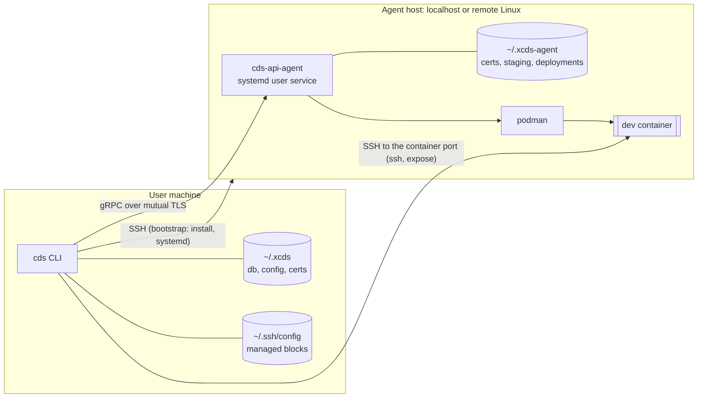
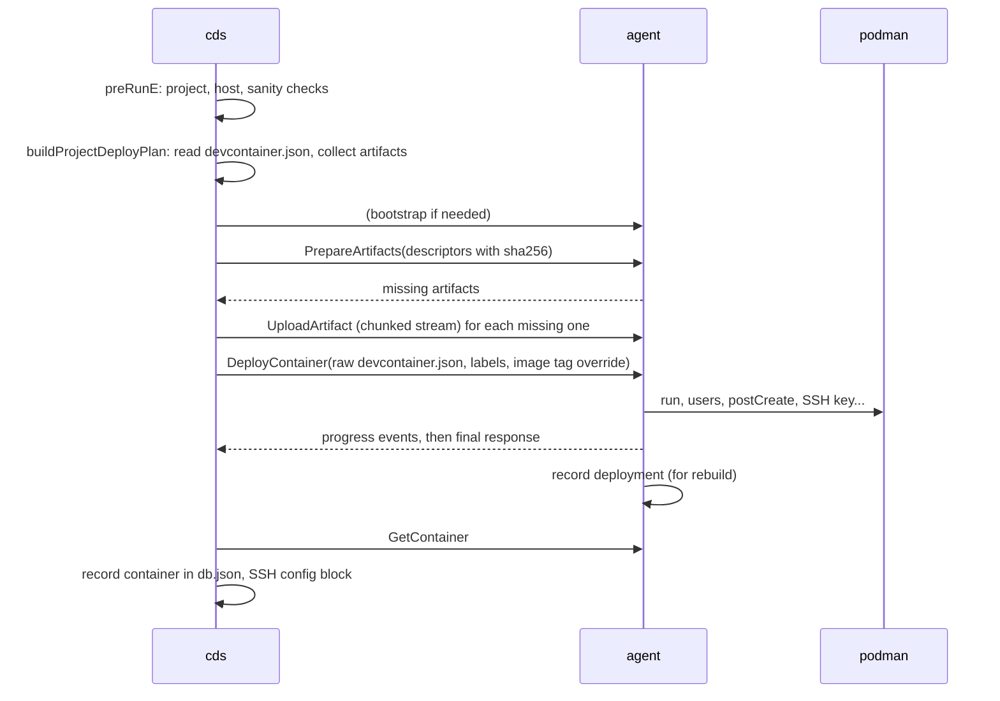

# CDS architecture

CDS (Containers Development Space) deploys and manages development containers
described by a `devcontainer.json`, on the local machine or on remote Linux
hosts. This document describes how the code is organised and how to find your
way in it.

## Overview

CDS is a client/server application made of two binaries:

| Binary | Entry point | Role |
| --- | --- | --- |
| `cds` | `cmd/client/cds.go` | CLI. Validates and prepares inputs, keeps the user state (projects, hosts, agents), talks to agents. |
| `cds-api-agent` | `cmd/api-agent/cds-api-agent.go` | gRPC server running on the host where containers live. Does the heavy lifting: container engine calls, artifact staging, rebuilds. |



There is one agent per host. A project is bound to a host, and the CLI calls
the agent of the project host. Agents are started on demand: the first call to
an agent during a command bootstraps it when it is not running (see
[Agent bootstrap](#agent-bootstrap)).

## Layers and packages

All code lives under `internal/`; `cmd/` only holds the two `main` packages.

### CLI side

| Package | Responsibility | Start with |
| --- | --- | --- |
| `command` | Cobra commands (`cds project ...`, `cds space ...`, `cds version`) and the client of the agent. | `cds.go`, `project.go`, `client_grpc.go` |
| `bootstrap` | Makes sure the agent of a host runs: PKI, agent binary, systemd/exec start, health check, registration. | `boot.go`, `local.go`, `remote.go` |
| `config` | CLI and agent configuration files, settings read through Viper. | `manifest.go`, `cli.go`, `settings.go` |
| `db` | User state: projects, containers, hosts, current context (`db.json`). | `bom.go`, `project.go`, `host.go` |
| `host` | A host reachable through SSH (`Execute`, `Copy`, `Build`, `Load`). | `host.go` |
| `systemd` | systemd user units of the agent on a host. | `systemd.go` |
| `tls` (`cdstls`) | Certificates (cfssl) and TLS configuration. | `certs.go`, `files.go` |
| `output` | Rendering of command results (text/JSON). | `model.go` |
| `profile` | User profile loading. | `profile.go` |

### Agent side

| Package | Responsibility | Start with |
| --- | --- | --- |
| `agent` | gRPC services: `AgentInfoService`, `ContainerService` and `ArtifactService`. Holds the staging and recorded deployments. | `agent.go`, `container_service.go`, `artifact_service.go` |
| `engine` | Builds and runs podman/docker commands from a devcontainer configuration. | `engine.go`, `containersengine.go` |
| `core` | Agent command manager (version). | `core.go` |

### Shared

| Package | Responsibility |
| --- | --- |
| `api/v1` | Protobuf definitions. The Go code is generated into `api/v1/cdspb` (`make build-pb`) and is not versioned. |
| `containerconf` | `devcontainer.json` parsing (Viper based), artifact collection, resource identifiers, default SSH key pair. |
| `features` | Devcontainer features (embedded features). |
| `shexec` | Local and SSH command execution, SSH keys, file copy, port forwarding. |
| `cenv` | Configuration directories, filesystem helpers. |
| `cos` | Filesystem abstraction (afero), mockable in tests. |
| `cerr`, `clog` | Error wrapping with call sites, logging. |
| `global` (`cg`) | Constants and small helpers. |
| `bo` | Business objects shared by layers (`Container`, `Host`...). |
| `source`, `scm`, `ar`, `authmgr` | Configuration sources (local, SCM), Bitbucket and Artifactory clients, credentials. Mostly scaffolding for now. |

## On-disk layout

The configuration root is `$HOME`, or `$CDS_CONFIG_PATH` when set. Set it to a
scratch directory to keep experiments away from your real configuration.

```
<root>/.xcds/                      CLI (cenv client mode)
    cdsconfig.yaml                 manifest: where the files below come from
    cliconfig.yaml                 registered agents (address + TLS material)
    db.json                        projects, containers, hosts, context
    profile.json
    certs/ca.pem ca-key.pem        cds CA (the CLI is the trust root)
    certs/client.pem client-key.pem
    certs/agents/<host>/           server certificate issued for a remote host
    cache/agents/<version>/<os>-<arch>/cds-api-agent   downloaded agent binaries

<root>/.xcds-agent/                agent (cenv agent mode)
    aconfig.yaml                   clients registered on the agent
    certs/ca.pem agent-srv.pem agent-srv-key.pem
    bin/<version>/cds-api-agent    remote hosts: installed agent binary
    cache/staging/<project>/...    artifacts uploaded for deploys
    cache/deployments/<container>.json   recorded deploys, used by rebuild

~/.config/systemd/user/cds.socket, cds.service   agent units (Linux hosts)
~/.ssh/config                      "# >>> CDS managed host <container>" blocks
```

## Main flows

### Calling an agent

`command/client_grpc.go` is the only client of the agent:

```go
stubCallback(func(c agentServices, ctx context.Context) error {
    _, err := c.container.StartContainer(ctx, &cdspb.StartContainerRequest{...})
    return err
}).executeOn(hostname /*, withLongTimeout(), withoutAutostart() */)
```

`executeOn`:

1. Ensures the agent runs: `bootstrap.StartAgent`, once per command and host.
2. Resolves the address and TLS material registered for the host (`config.AgentAddress`, `config.RegisteredAgent`).
3. Dials with mutual TLS, verifying that the agent certificate is issued for the host name.
4. Runs the callback with a timeout (30 s, or 30 min for container builds).

Project commands use `onProjectAgent(projectName, callback)`, which targets the
project host (`project_agent.go`).

### `cds project run`



Code: `command/project_run.go` → `command/project_deploy.go` →
`agent/container_service.go` (`DeployContainer`) → `agent/container_ops.go` →
`engine`.

The other project commands follow the same shape: validate locally, call the
agent, then mirror what the agent reports in the db and the SSH config
(`command/project_containers.go`).

| Command | Agent RPCs |
| --- | --- |
| `start` / `stop` | `ListContainers`, `Start/StopContainer`, `GetContainer` |
| `sync` | `ListContainers`, `GetContainer` |
| `clear`, `delete` | `ListContainers`, `DeleteContainer` (with project: staging removed) |
| `rebuild` | `PrepareArtifacts`/`UploadArtifact`, `RebuildContainer` (current config) |
| `rename` | `RenameContainer`, `GetContainer` |
| `share` / `unshare` | `ExecuteInContainer` (authorized keys scripts from `engine`) |
| `ssh`, `rsh`, `expose` | `ListContainers`/`GetContainer`, then SSH straight to the container port |
| `space host get` | `GetVersion`, without autostart |

### Agent bootstrap

`bootstrap.StartAgent(hostname)` (`bootstrap/boot.go`) returns
`StartOnRunError` when the agent registered for the host answers a TLS
`GetVersion` (`health.go`). Remote agents also have to run the CLI version.
Otherwise:

- **localhost** (`local.go`, `boot_<os>.go`):
  1. Provision the PKI (`cdstls.EnsureCerts`, which generates the CA only once).
  2. Resolve the agent binary (`agentbin.go`).
  3. Start it: systemd user units on Linux when available, a detached process otherwise.
  4. Wait until healthy, then register.
- **remote** (`remote.go`), in the spirit of the VS Code server:
  1. Load the host from the db, or configure SSH access on first use (`host.Build`).
  2. Probe the platform with `uname -sm`, and the home directory with `systemd-path user`.
  3. Install the agent binary matching the CLI version under `~/.xcds-agent/bin/<version>/` when it is missing or different (sha256 check, uploaded aside and then renamed).
  4. Install the CA and a server certificate issued for the host (`cdstls.AgentCertsDir`).
  5. Create, enable and restart the systemd user units (`internal/systemd`).
  6. Wait until healthy, then register (`config.UpsertAgentForHostInConfig`).

The agent binary is resolved, in order, from:

1. `CDS_AGENT_BINARY`, a path template using `{{os}}`, `{{arch}}` and `{{version}}`. It is meant for development, e.g. `$PWD/dist/cds-api-agent-{{os}}-{{arch}}` after `make build-api-agent-linux`.
2. For the local platform only: `PATH`, then the directory of the `cds` executable.
3. The local cache.
4. A download from `CDS_AGENT_DOWNLOAD_URL`, a URL template (https only).

## API

The services are defined in `internal/api/v1/services/*.proto`, and their
messages in `artifact/`, `container/` and `info/`.

| Service | RPCs |
| --- | --- |
| `AgentInfoService` | `GetVersion` |
| `ArtifactService` | `PrepareArtifacts`, `UploadArtifact` (client stream) |
| `ContainerService` | `DeployContainer` (server stream), `RebuildContainer`, `Start`, `Stop`, `Delete`, `Rename`, `Get`, `List`, `ExecuteInContainer` |

Artifacts are the files a `devcontainer.json` depends on: Dockerfile, auth
file, public key, files referenced by the configuration. They are identified
by logical identifiers such as `resource/dockerfile/Dockerfile` (see
`containerconf/identifier.go`). The agent stages them per project; their
digests avoid uploading them again.

After changing a `.proto` file, run `make build-pb`.

## Settings

Settings are read through Viper (`config/settings.go`) and can be set with
environment variables:

| Variable | Default | Purpose |
| --- | --- | --- |
| `CDS_CONFIG_PATH` | `$HOME` | Root of `.xcds` / `.xcds-agent` |
| `CDS_AGENT_PORT` | `8087` | Port agents listen on |
| `CDS_AGENT_BINARY` | | Agent binary path template |
| `CDS_AGENT_DOWNLOAD_URL` | | Agent binary download URL template |
| `CDS_OUTPUT` | `auto` | Output format (`auto`, `json`, `text`) |

## Code conventions

These recur everywhere; following them keeps new code consistent:

- **Commands:**
  - One file per command. Each command is a struct embedding `defaultCmd` and implementing `baseCmd` (`command()`, `subCommands()`).
  - The `*cobra.Command` is built lazily.
  - Files are split by banner comments: *Business logic*, *Implement `baseCmd` interface*, *Callback for gRPC*. See `command/version.go`.
- **Functional options:** `New(ops ...func(*T))` with `WithX(...)`, e.g. `host.New(host.WithName(...))`, `systemd.New(systemd.WithTarget(...))`, `agent.NewConfig(agent.WithLogger(...))`.
- **Naming:** unexported constants start with `k`, exported ones with `K`, package variables with `s`. Interface compliance is asserted with `var _ I = (*T)(nil)`.
- **Errors:** wrap with `cerr.AppendError` / `cerr.AppendErrorFmt` and never swallow them. At the gRPC boundary, return `status.Error(codes.X, ...)`.
- **Logging:** use `clog.Debug/Info/Warn/Error`, never `fmt.Println`.
- **Small consumer-side interfaces for testability:** e.g. `systemd.hostOps`, `bootstrap.remoteHost`, `agent.containerOps`.
- **Filesystem:** go through `cos` / `cenv` so that tests can mock it.

## Exploring the code

### Suggested reading order

1. `cmd/client/cds.go` and `cmd/api-agent/cds-api-agent.go`: process start-up, configuration, logging, TLS, listener.
2. `internal/command/cds.go`, `project.go` and `space.go`: the command tree.
3. `internal/command/client_grpc.go`, then one simple command (`version.go`), then one full flow (`project_run.go` → `project_deploy.go`).
4. `internal/agent/agent.go` → `container_service.go` → `container_ops.go` → `internal/engine/containersengine.go`.
5. `internal/bootstrap/boot.go` → `health.go` → `local.go` / `remote.go`.
6. `internal/db/bom.go` (the persisted model) and `internal/config/manifest.go` (where files come from).

### Useful commands

```bash
make help                          # all make targets
make build-pb                      # generate the gRPC code (needed before building)
go doc ./internal/bootstrap        # package documentation
go doc -u ./internal/command stubCallback.executeOn   # -u for unexported symbols
grep -rn "func (s \*containerServiceServer)" internal/agent   # RPC implementations
grep -rn "executeOn\|onProjectAgent" internal/command          # commands calling the agent
go test ./internal/agent/ -run TestRebuildContainer -v         # tests double as examples
```

### Tests as entry points

Tests use `testify`, except `ar`, `scm` and `source`, which use Ginkgo. They
isolate the filesystem through `t.TempDir()`, `CDS_CONFIG_PATH`, `HOME` or
`cos.SetMockedFileSystem()`. Reading them is often the fastest way to see a
component in action:

| Test | Shows |
| --- | --- |
| `command/project_agent_test.go` (+ `agent_testutils_test.go`) | Every project flow against an in-memory agent served over mutual TLS |
| `agent/container_service_test.go`, `artifact_service_test.go` | RPC behaviour with a fake container engine |
| `agent/container_ops_test.go`, `engine/containersengine_test.go` | Exact podman command lines, with a fake `podman` on `PATH` |
| `bootstrap/remote_test.go`, `health_test.go` | Remote bootstrap steps and health check |
| `systemd/systemd_test.go` | Unit generation and installation on a fake host |
| `tls/files_test.go` | PKI generation (needs `cfssl`) |

`internal/tls/tlstest` generates mutual TLS material in-process for tests.

### Running it locally without touching your configuration

```bash
make build-client build-api-agent
export CDS_CONFIG_PATH=$(mktemp -d)        # scratch .xcds / .xcds-agent
export PATH=$PWD:$PATH                      # cds-api-agent next to cds, cfssl/cfssljson on PATH too
./cds version -v                            # bootstraps the local agent
```

To try a remote Linux host, also build the agent for it and point the CLI to it:

```bash
make build-api-agent-linux
export CDS_AGENT_BINARY="$PWD/dist/cds-api-agent-{{os}}-{{arch}}"
./cds space host add <host>
```

`HOME` still decides where SSH keys and `~/.ssh/config` are written.

## Known gaps

- Orchestration (KinD), registry, `project drain` and `--src-repo` are not implemented yet (look for `TODO` in `internal/command`).
- Remote agents require a systemd user session (`loginctl enable-linger`).
- `shexec` accepts unknown SSH host keys when `known_hosts` is missing.
- Some engine defaults are environment specific (the `~/.devbox` mount).
